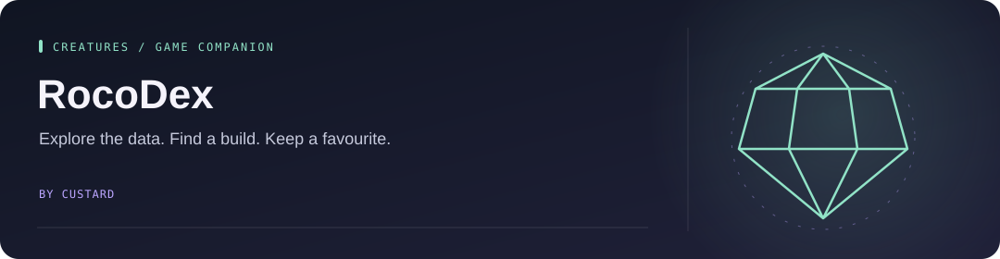
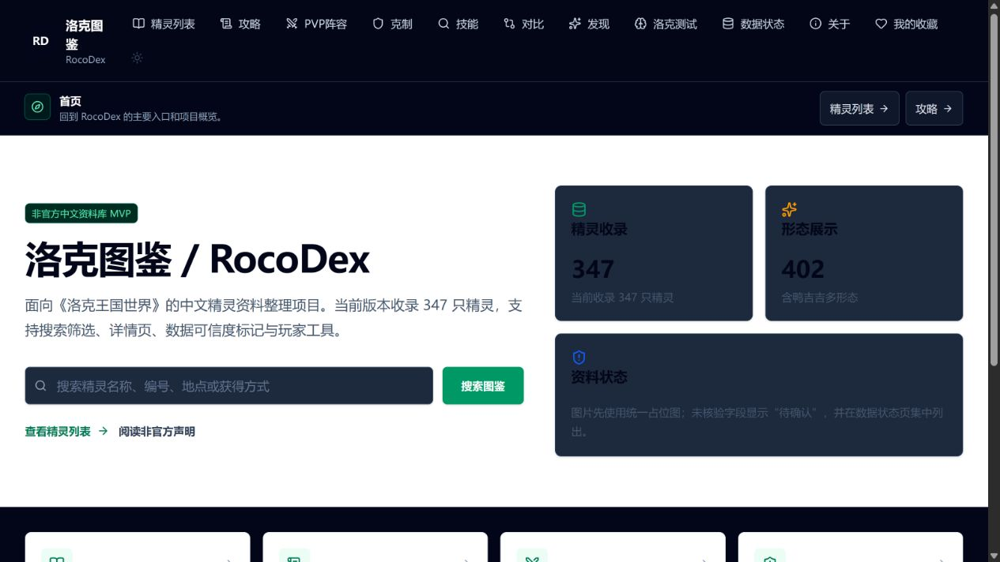

<!-- Project artwork created for this repository. -->
<p align="center">
  
</p>

<h1 align="center">RocoDex</h1>

<p align="center">
  
</p>

**A searchable Roco Kingdom creature guide, with builds, teams, and a personal collection.**

<p align="center"><a href="#what-is-here">What is here</a> &nbsp; · &nbsp; <a href="#run-locally">Run locally</a> &nbsp; · &nbsp; <a href="#find-your-way-around">Find your way around</a></p>

[Open RocoDex](https://rocodex.custard.top) · [Architecture](docs/architecture.md) · [Data sources](docs/guide_sources.md)


<p align="center">
  
</p>

<sub>Live RocoDex interface, captured on 2026-10-10. The app is primarily Chinese.</sub>


## What is here

- Creature data, search, and filters.
- Build guides, PvP teams, and locally saved favorites.
- A separate personal website in the same deployment. Its routes and product code stay separate from RocoDex.

RocoDex is in maintenance: the focus is reliability, compatibility, and fixes.

The live sites share the `custard-web-platform` Cloudflare Worker, built with OpenNext. `rocodex.custard.top` serves RocoDex; `custard.top` and `www.custard.top` serve the personal site.

## Run locally

Use Node.js **24.x** and the npm version in `package.json`.

```bash
npm ci
npm run dev
```

Open `http://localhost:3000` for RocoDex or `/cstd` for the separate personal site. Account features require `AUTH_SECRET` or `NEXTAUTH_SECRET`.

## Find your way around

| Area | Location |
| --- | --- |
| RocoDex pages | `src/app/(rocodex)/` |
| Creature, build, and team data | `src/data/` |
| Personal website | `src/sites/personal-homepage/` |
| Site boundaries and routing | [Architecture](docs/architecture.md) |
| Setup, checks, and deployment | [Maintenance reference](docs/MAINTENANCE.md) |

Use `npm run verify` for the main checks and `npm run test:e2e:rocodex` for the RocoDex browser tests.

This is an unofficial fan project. See the [disclaimer](DISCLAIMER.md), [data gaps](docs/data_gaps.md), and [PvP sources](docs/pvp_sources.md).
